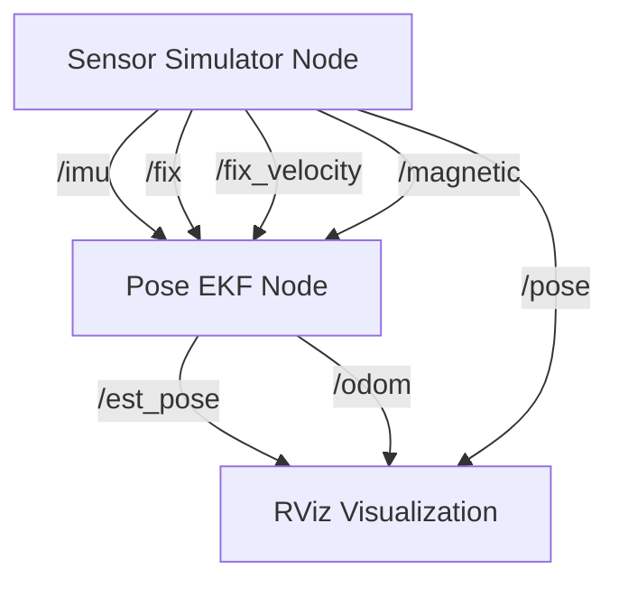
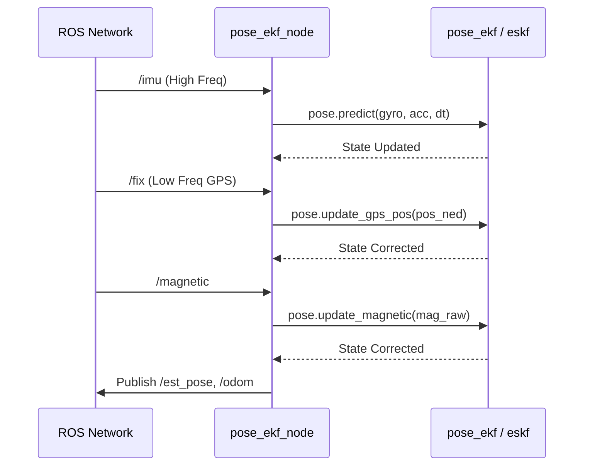

# Architecture Overview

## System Summary

`pose_ekf` is a ROS (Robot Operating System) package built with C++ and Eigen3. It implements an Error-State Kalman Filter (ESKF) for 6D pose estimation by fusing data from GPS, IMU, and a magnetometer. It also includes a built-in sensor simulator to generate synthetic noisy sensor data for testing.

**Tech Stack:**

- Framework: ROS 1 (roscpp)
- Language: C++11
- Math/Linear Algebra: Eigen3
- Coordinate Transformations: RTKLIB
- Visualization: RViz

## High-Level Architecture



## Project Structure

```
.
├── CMakeLists.txt      # Build configuration for ROS catkin
├── package.xml         # ROS package dependencies and metadata
├── launch/             # ROS launch files
│   └── pose_ekf_simulator.launch
├── rviz/               # Visualization configuration
│   └── pose_eskf.rviz
└── src/                # C++ Source Code
    ├── pose_ekf_node.cpp       # EKF ROS wrapper and entry point
    ├── pose_ekf.cpp/.h         # EKF state management
    ├── eskf.cpp/.h             # Core Error-State Kalman Filter math
    ├── sensor_simulator_node.cpp # Simulator ROS wrapper
    ├── sensor_simulator.cpp/.h   # Ground truth trajectory generation
    ├── noise_simulator.cpp/.h    # Sensor noise generation
    ├── math_utils.cpp/.h         # Math and coordinate transformations
    └── sensor_config.h           # Noise parameters configuration
```

## Key Components

### Entry Points

**Pose Estimator Node:** `src/pose_ekf_node.cpp`

- The main application entry point for the estimator.
- Initializes ROS publishers and subscribers.
- Manages the `pose_ekf` instance.
- Translates ROS messages (e.g., `sensor_msgs/Imu`, `sensor_msgs/NavSatFix`) into Eigen vectors and feeds them into the filter.
- Publishes the resulting odometry, path, and pose.

**Sensor Simulator Node:** `src/sensor_simulator_node.cpp`

- The entry point for the synthetic data generator.
- Generates ground truth state (position, velocity, orientation).
- Applies Gaussian noise and random walk biases to simulate real sensors.
- Publishes topics simulating an IMU, GPS, and Magnetometer.

### Core Modules

**State Estimation (`src/eskf.cpp`, `src/pose_ekf.cpp`)**

- Tracks a 15-DOF state: Position (3), Velocity (3), Quaternion Attitude (4), Accel Bias (3), Gyro Bias (3).
- Uses the Error-State formulation: `[dp dv d_theta dba, dbw]`.
- Implements IMU-driven Prediction steps.
- Implements GPS and Magnetometer-driven Update steps.
- Operates primarily in the NED (North-East-Down) inertial frame.

**Simulation (`src/sensor_simulator.cpp`, `src/noise_simulator.cpp`)**

- Generates a kinematic trajectory.
- Models sensor noise characteristics including white noise density and bias random walk, defined in `src/sensor_config.h`.

**Math Utilities (`src/math_utils.cpp`)**

- Quaternion and Euler angle conversions.
- Skew-symmetric matrix generation.
- Earth frame coordinate conversions (WGS84, ECEF, ENU, NED) leveraging RTKLIB.

## Data Flow

### Filter Update Cycle



### Request Lifecycle

1. **Sensor Input:** High-frequency IMU data arrives at `imuCallback`. The filter performs a prediction step integrating the acceleration and angular velocity.
2. **Measurement Input:** Low-frequency GPS or Magnetometer data arrives at `fixCallback` or `magCallback`.
3. **Coordinate Transformation:** GPS LLA (Latitude, Longitude, Altitude) is converted to ECEF, then to ENU, and finally to the local NED frame.
4. **Correction:** The filter computes the Kalman gain and updates the error state, which is then injected into the nominal state.
5. **Output:** The node extracts the position and orientation quaternion from the filter, formats them into ROS `PoseStamped` and `Odometry` messages, and publishes them.

## Key Files Reference

| File | Purpose | Modify For |
| :--- | :--- | :--- |
| `src/eskf.cpp` | Core filter mathematics | Changing covariance matrices or state equations |
| `src/pose_ekf_node.cpp` | ROS interfaces for EKF | Adding new sensor subscribers or changing topics |
| `src/sensor_simulator_node.cpp` | ROS interfaces for Simulator | Changing simulation frequency or published topics |
| `src/sensor_config.h` | Noise parameters | Tuning simulated sensor quality |
| `launch/pose_ekf_simulator.launch` | Node orchestration | Changing topic remaps or node arguments |
| `src/math_utils.cpp` | Coordinate transforms | Adding new frame conversions |

## Dependencies

### Critical Dependencies

- `roscpp` - ROS C++ client library for node management and communication.
- `sensor_msgs`, `nav_msgs`, `geometry_msgs` - Standard ROS message types for sensor data and poses.
- `tf` - ROS transform library.
- `Eigen3` - C++ template library for linear algebra, matrices, and vectors.
- `RTKLIB` - Used for geodetic coordinate transformations (e.g., pos2ecef, ecef2enu).

## Development Workflow

1. **Local setup:** Standard ROS catkin workspace setup.
   ```bash
   mkdir -p ~/catkin_ws/src
   cd ~/catkin_ws/src
   # Clone repository here
   cd ~/catkin_ws
   catkin_make -DCATKIN_WHITELIST_PACKAGES="pose_ekf"
   source devel/setup.bash
   ```
2. **Running the Simulator:**
   ```bash
   roslaunch pose_ekf pose_ekf_simulator.launch
   ```
   This launches the simulator node, the estimator node, and RViz for visual feedback.
3. **Using Real Data:** Modify the launch file or create a new one that only launches `pose_eskf` and remaps the topics to your actual hardware or rosbag topics.

## Troubleshooting

**Missing RTKLIB**

- The project expects RTKLIB headers to be at `/usr/local/include/rtklib` and the library to be linked via `librtklib.a`. If compilation fails with missing headers or undefined references to `pos2ecef`, ensure RTKLIB is installed system-wide or adjust the `CMakeLists.txt` include directories and target link libraries to point to your local RTKLIB build.

**Filter Divergence**

- If the pose flies off to infinity in RViz, the filter may have diverged. Check `sensor_config.h` to ensure the simulated noise isn't too large for the filter's hardcoded covariances, or check `eskf.cpp` to tune the process and measurement noise covariance matrices (Q and R).

**Frame Issues**

- The filter operates internally in the NED frame. Ensure any external sensor data fed into the filter is correctly transformed from its native frame (e.g., ENU or camera frame) into the NED frame before being passed to `pose.predict()` or `pose.update_*()`.