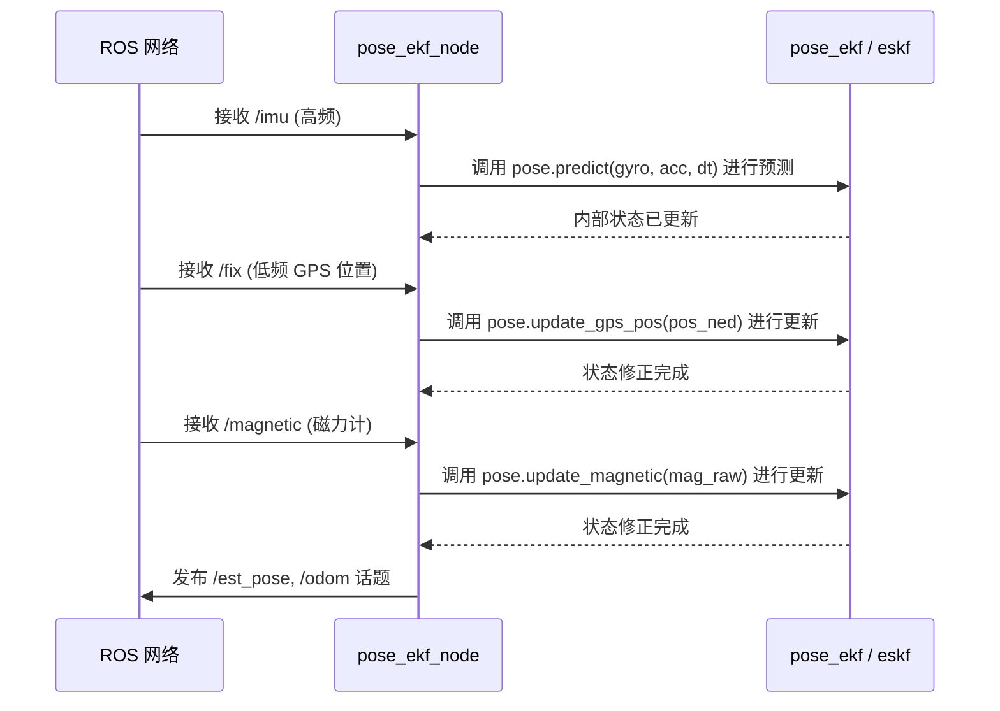

# 架构总览

## 系统概述

`pose_ekf` 是一个基于 ROS（机器人操作系统）构建的软件包，使用 C++ 和 Eigen3 开发。它实现了一个**误差状态卡尔曼滤波器 (ESKF)**，用于融合 GPS、IMU 和磁力计的数据，进行 6 自由度（6D）位姿估计。此外，该项目还包含一个内置的传感器模拟器，能够生成带有噪声的合成传感器数据，方便进行测试和验证。

**技术栈：**

- 框架：ROS 1 (roscpp)
- 语言：C++11
- 数学/线性代数：Eigen3
- 坐标转换：RTKLIB
- 可视化：RViz

## 高层架构

```mermaid
graph TB
    Sim[传感器模拟器节点] -->|/imu| EKF[位姿 EKF 节点]
    Sim -->|/fix| EKF
    Sim -->|/fix_velocity| EKF
    Sim -->|/magnetic| EKF
    EKF -->|/est_pose| RViz[RViz 可视化]
    EKF -->|/odom| RViz
    Sim -->|/pose (真值)| RViz
```

## 项目结构

```text
.
├── CMakeLists.txt      # ROS catkin 的构建配置文件
├── package.xml         # ROS 软件包的依赖与元数据
├── launch/             # ROS 启动文件目录
│   └── pose_ekf_simulator.launch
├── rviz/               # 可视化配置文件目录
│   └── pose_eskf.rviz
└── src/                # C++ 源代码目录
    ├── pose_ekf_node.cpp       # EKF ROS 封装及主入口点
    ├── pose_ekf.cpp/.h         # EKF 状态管理类
    ├── eskf.cpp/.h             # 误差状态卡尔曼滤波器核心数学实现
    ├── sensor_simulator_node.cpp # 模拟器 ROS 封装及主入口点
    ├── sensor_simulator.cpp/.h   # 真实轨迹生成类
    ├── noise_simulator.cpp/.h    # 传感器噪声生成类
    ├── math_utils.cpp/.h         # 数学与坐标转换工具函数
    └── sensor_config.h           # 噪声参数宏定义配置
```

## 核心组件

### 入口点

**位姿估计节点 (Pose Estimator Node)：** `src/pose_ekf_node.cpp`

- 估计器的主应用程序入口。
- 初始化 ROS 的发布者 (Publishers) 和订阅者 (Subscribers)。
- 实例化并管理 `pose_ekf` 对象。
- 将 ROS 消息（如 `sensor_msgs/Imu`, `sensor_msgs/NavSatFix`）转换为 Eigen 向量格式，并将其输入到滤波器中。
- 发布最终估计的里程计 (odometry)、轨迹 (path) 和位姿 (pose)。

**传感器模拟器节点 (Sensor Simulator Node)：** `src/sensor_simulator_node.cpp`

- 合成数据生成器的入口。
- 生成绝对真实的系统状态（位置、速度、姿态）。
- 叠加高斯白噪声和随机游走偏置（由 `noise_simulator` 生成），以模拟真实的传感器特性。
- 发布模拟的 IMU、GPS 和磁力计话题数据。

### 核心模块

**状态估计 (`src/eskf.cpp`, `src/pose_ekf.cpp`)**

- 跟踪 15 个自由度 (15-DOF) 的状态：位置 (3), 速度 (3), 四元数姿态 (4), 加速度计偏置 (3), 陀螺仪偏置 (3)。
- 使用误差状态表示法：`[dp dv d_theta dba, dbw]`。
- 实现了由 IMU 驱动的**预测 (Predict)** 步骤。
- 实现了由 GPS 和磁力计驱动的**更新 (Update)** 步骤。
- 滤波器主要在 **NED** (北-东-地) 惯性坐标系下运行。

**模拟器 (`src/sensor_simulator.cpp`, `src/noise_simulator.cpp`)**

- 生成运动学轨迹。
- 根据 `src/sensor_config.h` 中定义的参数，对传感器噪声特性进行建模，包括白噪声密度 (noise density) 和偏置随机游走 (random walk)。

**数学工具 (`src/math_utils.cpp`)**

- 四元数和欧拉角之间的相互转换。
- 反对称矩阵 (Skew-symmetric matrix) 生成。
- 利用 RTKLIB 进行地球参考系相关的坐标转换（例如 WGS84, ECEF, ENU, NED 之间的转换）。

## 数据流向

### 滤波器更新周期



### 请求生命周期 (Request Lifecycle)

1. **传感器输入：** 高频 IMU 数据到达 `imuCallback` 回调函数。滤波器执行**预测 (Prediction)** 步骤，积分加速度和角速度。
2. **观测输入：** 低频的 GPS 或磁力计数据到达 `fixCallback` 或 `magCallback`。
3. **坐标转换：** GPS 传来的 LLA (经度、纬度、高度) 数据被转换为 ECEF 坐标，再转换为 ENU 坐标，最后转换为局部的 NED 坐标系。
4. **校正：** 滤波器计算卡尔曼增益 (Kalman gain)，更新误差状态，然后将误差状态注入（注入/重置过程）到名义状态中。
5. **输出：** 节点从滤波器中提取最新的位置和姿态四元数，将它们打包成 ROS 的 `PoseStamped` 和 `Odometry` 消息并发布出去。

## 关键文件参考

| 文件名 | 职责 / 用途 | 何时需要修改它 |
| :--- | :--- | :--- |
| `src/eskf.cpp` | 滤波器核心数学推导和实现 | 需要更改协方差矩阵或修改状态方程时 |
| `src/pose_ekf_node.cpp` | 估计器的 ROS 接口层 | 需要添加新的传感器订阅或更改话题名称时 |
| `src/sensor_simulator_node.cpp` | 模拟器的 ROS 接口层 | 需要更改模拟频率或调整发布的测试话题时 |
| `src/sensor_config.h` | 传感器噪声参数配置 | 想要调整模拟传感器的质量或误差大小 |
| `launch/pose_ekf_simulator.launch` | ROS 节点编排和启动 | 更改话题重映射或节点运行参数 |
| `src/math_utils.cpp` | 坐标变换及基础数学 | 需要添加新的参考系转换方法时 |

## 外部依赖

### 核心依赖

- `roscpp` - ROS 的 C++ 客户端库，用于节点管理和通信。
- `sensor_msgs`, `nav_msgs`, `geometry_msgs` - 标准的 ROS 消息类型，用于传递传感器数据和位姿。
- `tf` - ROS 的坐标系变换库。
- `Eigen3` - C++ 模板库，提供线性代数、矩阵和向量运算。
- `RTKLIB` - 强大的开源导航库，在此项目中主要用于大地测量坐标系的转换（例如 `pos2ecef`, `ecef2enu` 等函数）。

## 开发工作流

1. **本地环境设置：** 标准的 ROS catkin 工作空间设置流程。
   ```bash
   mkdir -p ~/catkin_ws/src
   cd ~/catkin_ws/src
   # 将代码仓库克隆到此处
   cd ~/catkin_ws
   catkin_make -DCATKIN_WHITELIST_PACKAGES="pose_ekf"
   source devel/setup.bash
   ```
2. **运行模拟器进行测试：**
   ```bash
   roslaunch pose_ekf pose_ekf_simulator.launch
   ```
   这个 launch 文件会同时启动模拟器节点、估计器节点，并打开 RViz 进行可视化展示。
3. **使用真实数据：** 修改 launch 文件，或者创建一个新的 launch 文件，只启动 `pose_eskf` 节点，并通过 `<remap>` 标签将订阅的话题映射到你实际硬件或 rosbag 提供的主题上。

## 常见问题排查 (Troubleshooting)

**找不到 RTKLIB 依赖报错**

- 该项目在 `CMakeLists.txt` 中硬编码了 RTKLIB 的头文件路径为 `/usr/local/include/rtklib`，且链接库为 `librtklib.a`。如果编译时提示找不到头文件或 `pos2ecef` 等符号未定义，请确保你已经在系统层面编译安装了 RTKLIB，或者手动修改 `CMakeLists.txt` 中的 `include_directories` 和 `target_link_libraries`，指向你本地存放 RTKLIB 的实际路径。

**滤波器发散 (Filter Divergence)**

- 如果在 RViz 中发现位姿飘到无穷远，说明滤波器可能已经发散。
- 可以检查 `sensor_config.h`，确保模拟注入的噪声没有大到超出滤波器预设协方差的承受范围；
- 或者检查 `eskf.cpp`，重新调整过程噪声和测量噪声的协方差矩阵（Q 阵和 R 阵）。

**坐标系匹配问题**

- 该滤波器内部固定使用 **NED**（北-东-地）坐标系进行推演。请务必确保任何喂给滤波器的外部传感器数据，在传入 `pose.predict()` 或 `pose.update_*()` 方法前，都已经从其原生的坐标系（比如 ENU 或者相机坐标系）正确转换到了 NED 坐标系。